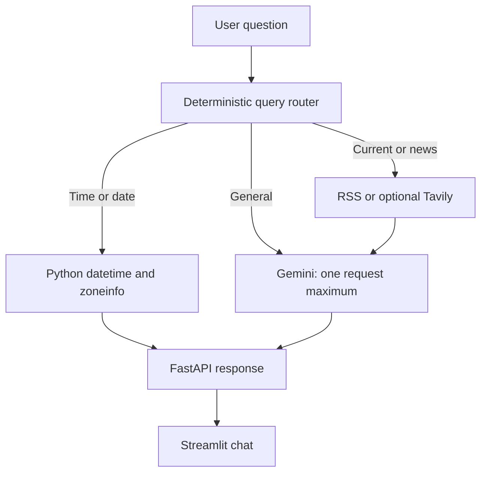

# Live News AI

Live, source-grounded news Q&A with a Gemini model, public RSS fallback, optional Tavily search, clickable citations, local time answers, and multi-turn conversation history.

## Architecture



The router never calls Gemini. Time and date questions use local Python only. General questions use Gemini without news retrieval. Current questions retrieve articles first, then use one Gemini request to summarize the supplied evidence.

## Features

- Current-news retrieval for geopolitical, regional, political, weather, technology, and other news queries.
- Free public RSS search through Google News, BBC, NPR, and The Guardian.
- Optional Tavily news search when `TAVILY_API_KEY` is configured.
- Source metadata from retrieved articles: title, publisher, publication date, and URL.
- Local timezone answers without a network request or API key.
- Request-scoped Gemini guard: no more than one Gemini call per user request.
- Conversation history preserved per session.
- Bounded external requests and no automatic Gemini retries.

## Stack

Python 3.11+, FastAPI, Streamlit, LangChain, LangGraph, `langchain-google-genai`, Google Gemini, Tavily, feedparser, httpx, BeautifulSoup, pytest, and Ruff.

## Requirements

Install [uv](https://docs.astral.sh/uv/) and use Python 3.11 or newer.

## Installation

```powershell
uv sync --dev
```

Create a `.env` file in the project root. It is ignored by git. At minimum, set:

```dotenv
GEMINI_API_KEY=your_gemini_api_key
GEMINI_MODEL=gemini-3.7-flash
```

Get a Gemini key from Google AI Studio. Do not commit `.env` or share its contents. `OPENAI_API_KEY` is accepted only as a legacy alias for the Gemini key; `OPENAI_MODEL` is not used.

## Environment Variables

| Variable | Default | Description |
| --- | --- | --- |
| `GEMINI_API_KEY` | none | Gemini API key; required for general and current-news answers |
| `GEMINI_MODEL` | `gemini-3.7-flash` | Gemini API model ID |
| `TAVILY_API_KEY` | none | Optional primary news search key; RSS remains available without it |
| `APP_HOST` | `127.0.0.1` | FastAPI bind host |
| `APP_PORT` | `8000` | FastAPI port |
| `APP_TIMEZONE` | `UTC` | Default timezone for unspecified local time questions |
| `MAX_SEARCH_RESULTS` | `8` | Configured search limit; news retrieval caps each request at five |
| `MAX_SOURCES_PER_ANSWER` | `6` | Source limit setting |
| `MAX_ARTICLE_CONTENT_CHARS` | `12000` | Article content limit setting |
| `STREAMLIT_API_URL` | `http://127.0.0.1:8000` | Backend URL used by the frontend |

## News Retrieval

RSS retrieval is free and does not require an API key. Google News RSS receives the user query directly; BBC, NPR, and Guardian public feeds provide additional coverage. Feeds are fetched concurrently with a five-second timeout per feed. Failed feeds do not prevent other feeds from being used.

If Tavily is configured, it is tried first. When it fails or returns no articles, the application falls back to RSS. Retrieved article metadata is passed to Gemini as bounded evidence; Gemini does not search independently or invent citations.

## Query Routing and Gemini Usage

```text
Time/date query       -> local datetime/zoneinfo -> 0 Gemini calls
General question      -> Gemini                     -> 1 Gemini call maximum
Current/news question -> RSS/Tavily -> Gemini       -> 1 Gemini call maximum
```

Gemini is configured with no automatic retries and a 20-second request timeout. Each backend request logs its query type, Gemini call count, and retrieved source count.

## Running

Start the backend:

```powershell
uv run uvicorn app.main:app --reload --host 127.0.0.1 --port 8000
```

In a second terminal, start the Streamlit frontend:

```powershell
uv run streamlit run frontend/streamlit_app.py
```

Health check: `http://127.0.0.1:8000/api/health`

## Testing

```powershell
uv run pytest
uv run ruff check .
```

Useful manual questions:

- `What is the capital of Bangladesh?` uses the general path.
- `What time is it in Bangladesh?` uses local time and makes no API calls.
- `What time is it in London?` uses the London timezone locally.
- `What is happening in Gaza right now?` retrieves current sources before summarizing.
- `What are the latest news in Bangladesh?` retrieves query-specific current sources.
- `When did Bangladesh become independent?` uses the general path.

## API

### `GET /api/health`

Returns service status and whether Gemini and Tavily keys are configured. Secret values are never returned.

### `POST /api/chat`

Request:

```json
{
  "session_id": "example-session",
  "message": "What is happening in Gaza right now?"
}
```

The response contains `answer`, `sources`, `confidence`, `searched_at`, `query`, and `session_id`.

### `DELETE /api/session/{session_id}`

Clears the backend history for a session.

## Project Structure

- `app/config.py` loads validated environment settings.
- `app/llm.py` owns the Gemini adapter, compatibility wrapper, and one-call guard.
- `app/services/query_router.py` classifies queries and answers local time questions.
- `app/services/news_search.py` coordinates Tavily and RSS retrieval.
- `app/services/rss_news.py` fetches public RSS feeds.
- `app/graph/workflow.py` performs deterministic search-or-generate orchestration.
- `app/main.py` owns FastAPI routes, sessions, and request logging.
- `frontend/streamlit_app.py` owns the chat UI.
- `tests/` contains unit and API tests.

## Troubleshooting

- If the UI cannot connect, start FastAPI first and verify the sidebar backend URL.
- If Gemini returns `429`, the free-tier quota has been reached. The application does not retry automatically; wait for the quota reset.
- If no Tavily key is configured, RSS fallback remains available.
- If current news cannot be retrieved, the application does not claim that no news exists; it reports that reliable current sources could not be retrieved.

## Security

Keep API keys in `.env`, which is excluded by `.gitignore`. The application redacts configured keys from error responses and never returns them from the health endpoint.
